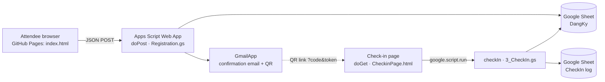

# Decree 284/2026 Compliance Seminar — Registration & Check-in System

A serverless event registration and on-site check-in system built on **Google Apps Script**, **Google Sheets** and **GitHub Pages**. Attendees register on a static landing page, receive an emailed pass with a signed QR code, and staff check them in at the door from a PIN-protected page.

**Live site:** https://celinatrix.github.io/CRYPTO-284-GR3/

---

## Why this exists

The seminar needed a registration flow that was free to run, easy for a student team to operate, and safe with attendees' personal data. A Google Form and a shared spreadsheet would have worked, but they offer no control over validation, bot traffic, duplicate sign-ups, or who can mark a ticket as used. This project keeps the zero-cost Google stack and adds the backend controls that a public form lacks.

## Features

- **Static landing page** on GitHub Pages: event information, agenda and the registration form, with VI / EN / 中文 localization and light/dark themes.
- **Server-side registration** (`doPost`) with full re-validation, a field whitelist, a honeypot, a minimum fill-time check, rate limiting and silent de-duplication by email.
- **Ticket issuing:** a unique `ND284-####` code plus an HMAC-SHA256 token bound to the ticket and email, stored in Google Sheets.
- **Confirmation email** with a QR code that links to the check-in page, a masked phone number, and an "Add to Google Calendar" link; the organizer gets a notification for every new registration.
- **Staff check-in page** served by the same Apps Script project: PIN-protected, verifies the ticket token, blocks double check-in, and writes an audit row to a separate sheet.

## Architecture



**Design decisions**

| Decision | Reason |
|---|---|
| Landing page on GitHub Pages, backend on Apps Script | Free hosting, version-controlled front end, and no server to maintain. |
| Check-in uses `google.script.run`, not a second HTTP endpoint | An Apps Script Web App exposes exactly one `doGet` and one `doPost`. `doPost` is taken by registration, so check-in calls the server function directly from the page served by `doGet`. |
| Secrets in Script Properties | The Sheet ID, HMAC key and PIN hash never appear in source code or Git history. |
| Same response for new and duplicate registrations | The form cannot be used to discover which emails are already registered. |

## Security model

The backend follows a 20-point checklist. The full rule-by-rule mapping is in [`SECURITY-SUMMARY.md`](SECURITY-SUMMARY.md). The main controls are:

| Threat | Control | Where |
|---|---|---|
| Leaked credentials | Sheet ID, HMAC secret and PIN hash kept in `PropertiesService`; `.gitignore` excludes clasp and env files | `Config.gs`, `.gitignore` |
| Malformed or oversized input | Payload capped at 5 KB, uploads rejected, every field re-validated server-side against strict patterns | `Registration.gs` → `doPost`, `validateInput_` |
| Mass assignment | Only whitelisted fields are read; ticket code, status and timestamps are always server-generated | `Registration.gs` → `ALLOWED_FIELDS_` |
| Bots and spam | Hidden honeypot field, minimum 3-second fill time, rate limits per email and system-wide via `CacheService` | `checkHoneypot_`, `rateLimit_` |
| Ticket guessing | Ticket codes are short, so check-in also requires an HMAC-SHA256 token bound to code + email, compared in constant time | `Utils.gs` → `generateTicketToken_`, `timingSafeEqual_` |
| Unauthorized check-in | Staff PIN stored only as a salted SHA-256 hash; 5 wrong attempts in 10 minutes lock check-in for 15 minutes | `3_CheckIn.gs` |
| Spreadsheet formula injection | Cells starting with `= + - @` are neutralized before writing | `Utils.gs` → `sanitizeForSheet_` |
| HTML injection in email | All user data escaped before it is placed in the email body | `Utils.gs` → `escapeHtml_` |
| Personal-data exposure | Phone numbers masked in emails; no personal data in subjects or URLs; generic error messages to clients, details only in server logs | `2_SendConfirmEmail.gs`, `jsonResponse_` |
| Clickjacking of the check-in page | Default `X-Frame-Options` kept | `0_WebApp.gs` |

## Data model

Sheet **`DangKy`** (registrations), one row per attendee:

| Col | Field | Source |
|---|---|---|
| A | Registered at | server |
| B | Full name | attendee |
| C | Email | attendee |
| D | Phone (stored as text) | attendee |
| E | Organization | attendee |
| F | Sector / capacity (whitelisted options) | attendee |
| G | Question for the panel | attendee |
| H | Ticket code `ND284-####` | server |
| I | HMAC token | server |
| J | Check-in status | server |

Sheet **`CheckIn`**: timestamp and ticket code for each successful check-in. No extra personal data is stored there.

## Project structure

```
├── index.html                 # Landing page (GitHub Pages)
├── registration-section.html  # Registration form section (source for the landing page)
├── animations.css / .js       # Motion design (GSAP + ScrollTrigger, Lenis)
├── vendor.min.js              # Self-hosted third-party bundle
├── site-qr.png                # QR code linking to the live site
│
├── 0_WebApp.gs                # doGet → serves the staff check-in page
├── Registration.gs            # doPost → validation, anti-bot, rate limit, de-dup
├── 1_GenTicket.gs             # Ticket code + HMAC token, write to Sheet
├── 2_SendConfirmEmail.gs      # Confirmation email with QR, admin notification
├── 3_CheckIn.gs               # PIN + token verification, check-in, audit log
├── CheckinPage.html           # Staff check-in UI
├── Config.gs                  # Constants and secret accessors, one-time setupSecrets()
├── Utils.gs                   # Escaping, masking, HMAC, hashing, Sheet and response helpers
└── SECURITY-SUMMARY.md        # Rule-by-rule security notes
```

## Setup

1. **Google Sheet:** create a spreadsheet with two tabs, `DangKy` and `CheckIn`, using the columns above.
2. **Apps Script:** create a project and add all `.gs` files and `CheckinPage.html`.
3. **Secrets:** in `Config.gs`, temporarily fill in the real Sheet ID and staff PIN inside `setupSecrets()`, run it once from the editor, then delete those values from the code. The function stores the Sheet ID, a random HMAC secret and a salted PIN hash in Script Properties.
4. **Configure:** set `ADMIN_EMAIL`, `EVENT_NAME`, `EVENT_DATE_TEXT` and `TICKET_PREFIX` in `Config.gs`.
5. **Deploy:** Deploy → New deployment → Web app, execute as *Me*, access *Anyone*. Copy the `/exec` URL.
6. **Front end:** set `WEBAPP_URL` in the registration script to that URL and publish the repository with GitHub Pages.

> If column positions in your Sheet differ from the layout above, update the column indexes in `findRegistrationByEmail_`, `ticketCodeExists_` and `findRegistrationByTicket_`.

## Known limitations and next steps

- **Ticket space:** `ND284-####` allows 9,000 codes. That is fine for a seminar; a larger event should use longer codes.
- **QR generation** calls the public `api.qrserver.com` service. The QR payload contains only the check-in URL with code and token, no personal data. Self-hosting QR generation would remove this dependency.
- **Shared staff PIN:** all staff use one PIN. Per-staff accounts would give a better audit trail.
- **Column indexes are hard-coded;** reading them from the header row would make the Sheet layout safer to change.
- **No automated tests.** The validation and token functions are pure enough to cover with unit tests via `clasp` and a local runner.

## Tech stack

Google Apps Script (V8) · Google Sheets · GmailApp · CacheService · PropertiesService · HtmlService · GitHub Pages · HTML/CSS/JavaScript · GSAP · Lenis
